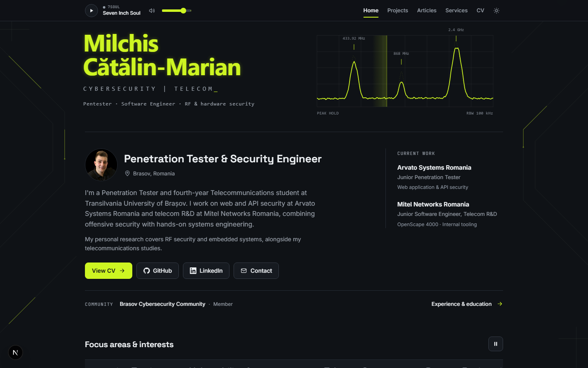
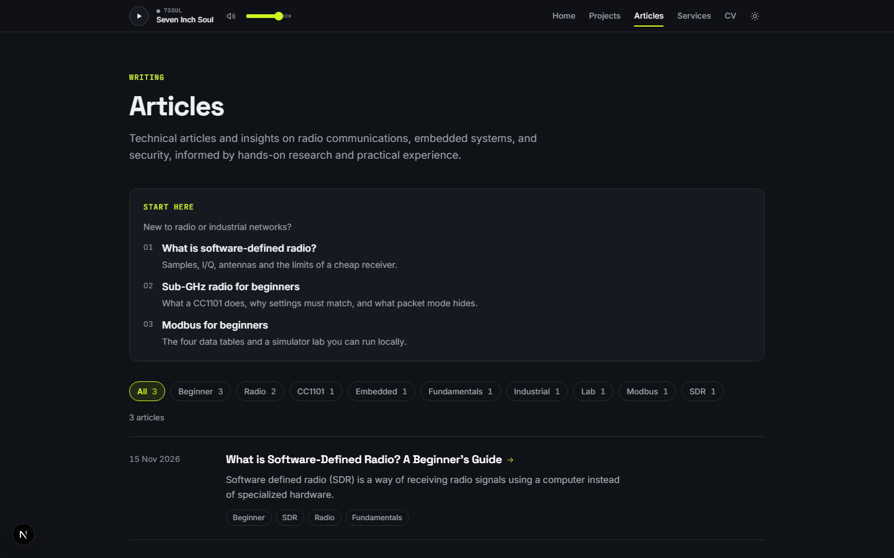
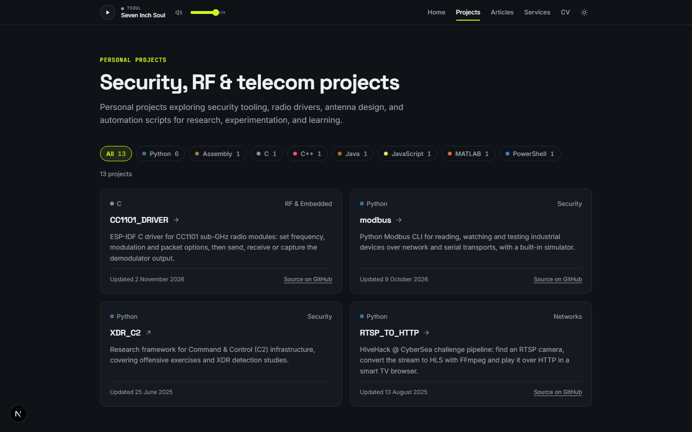
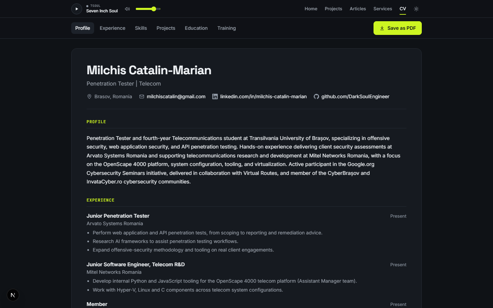
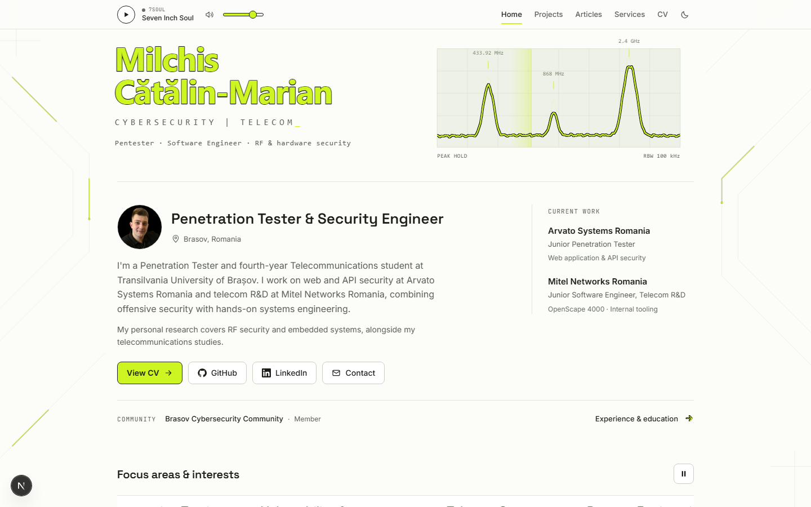

# PersonalWEB
**Personal blog and portfolio of Milchis Catalin-Marian — cybersecurity, RF security, and software development**

[](#license)


<p align="center">
  
</p>

## Table of Contents

- [Overview](#overview)
- [Key Features](#key-features)
- [Requirements](#requirements)
- [Installation](#installation)
- [Usage](#usage)
- [Screenshots](#screenshots)
- [Authoring Content](#authoring-content)
- [Related Links](#related-links)
- [License](#license)

## Overview

A fully static Next.js site: pages are generated at build time from Markdown
posts and JSON data, then served as plain HTML. There is no backend or
database. The live site is [milchiscatalin.com](https://milchiscatalin.com),
deployed on Vercel from `main`.

## Key Features

- Home with profile, focus areas, selected projects, and latest articles
- Articles archive with tag filtering and pagination; posts rendered from GitHub-flavored Markdown
- Projects page with a language filter and source-backed case studies (`/projects/cc1101-driver`, `/projects/modbus`, `/projects/rtsp-to-http`)
- CV page with full online detail and a one-page A4 print-to-PDF layout
- Radio player (SomaFM "Seven Inch Soul") and light/dark theme following the system setting
- SEO built in: per-page canonical URLs, Open Graph/Twitter cards, JSON-LD, sitemap, and a build-time SEO check (`npm run verify:seo`)
- Hardened static export: per-page CSP with hashed inline scripts, anti-framing and MIME-sniffing headers

## Requirements

- Node.js 20+ and npm

## Installation

```powershell
git clone https://github.com/DarkSoulEngineer/PersonalWEB.git
cd PersonalWEB\frontend
npm install
```

## Usage

```powershell
npm run dev        # dev server at http://localhost:3000
npm run build      # static export to frontend/out/
npm run lint
npm run verify:seo # post-build SEO checks
```

Serve `frontend/out/` with any static host. On Vercel, keep the Root Directory
at the repository root; the root `vercel.json` installs, builds, and serves the
export with clean URLs and security headers. For GitHub Pages, set
`basePath: "/PersonalWEB"` and `assetPrefix` in `frontend/next.config.ts`
before building.

To export the CV as PDF, use the print button on `/cv`: A4, 100% scale,
browser headers and footers disabled.

## Screenshots

Articles archive and project index:





CV page:



Light theme:



## Authoring Content

**Posts** are Markdown files in `frontend/content/posts/`; the file name is
the URL slug:

```markdown
---
title: My new article
description: A concise factual summary for search and social metadata.
author: Milchis Catalin-Marian
date: 2026-10-09
tags: security, radio
---

Article body in Markdown.
```

**Data** is plain JSON in `frontend/data/`: `profile.json` (home, footer, SEO),
`projects.json` (projects page), `cv.json` (CV page). Canonical URLs default to
`https://milchiscatalin.com`; override with `NEXT_PUBLIC_SITE_URL` only when
needed (HTTPS origin, no path).

## Related Links

- **[Live site](https://milchiscatalin.com)**: production deployment.
- **[Next.js static exports](https://nextjs.org/docs/app/guides/static-exports)**: the build mode used here.
- **[SomaFM](https://somafm.com/)**: the streamed radio channel.

## License

No license file is included yet; all rights reserved by the author. Article
content and photographs are personal work.

> [LinkedIn](https://www.linkedin.com/in/milchis-catalin-marian-824b61335/) &nbsp;&middot;&nbsp;
> GitHub [@DarkSoulEngineer](https://github.com/DarkSoulEngineer)